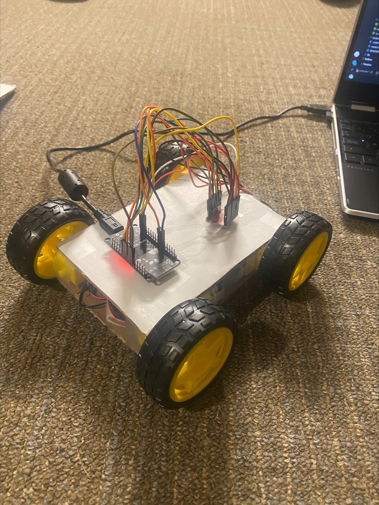
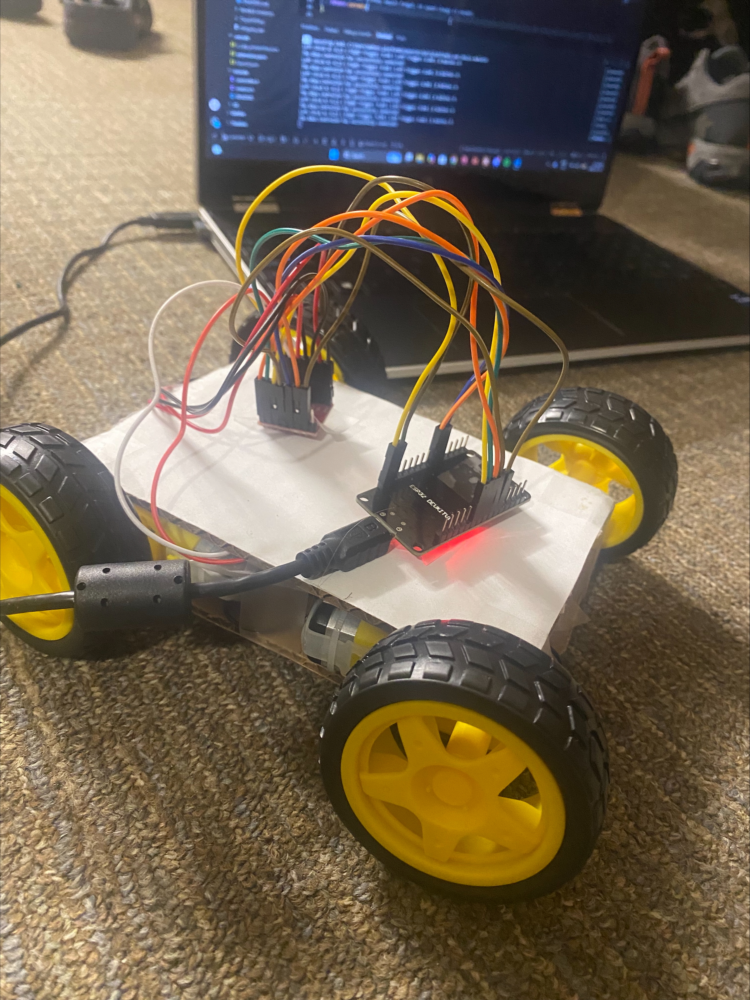

# esp32-rc-rover

Prototype of a remote-controlled car built around an ESP32. Team project: we're designing the vehicle ourselves in SolidWorks, 3D printing it, and writing the firmware. The longer-term goal is a rover that drives itself and maps the areas it travels through.

This is an early prototype, so things change often.

## What works so far

- ESP32 set up with PlatformIO in VS Code (blink test uploaded)
- Drive motors purchased
- First design: car-style layout, rear-wheel drive 
- Manual control scheme planned: right trigger forward, left trigger reverse, B to brake, with an arming step before it moves

Here are two photos of the prototype:
    
   

## Currently working on

- New chassis design in SolidWorks
- More sensors (thermal, ambient temperature, humidity so far)
- Making it autonomous

## Tech

ESP32, C++ (Arduino framework, PlatformIO), SolidWorks, 3D printing

## Repository layout

```
src/         firmware
docs/        notes
hardware/    parts list
cad/         SolidWorks files
```

## Build and upload

1. Install VS Code and the PlatformIO extension.
2. Open this folder in VS Code.
3. Connect the ESP32 over USB.
4. Build and upload from the PlatformIO toolbar.
